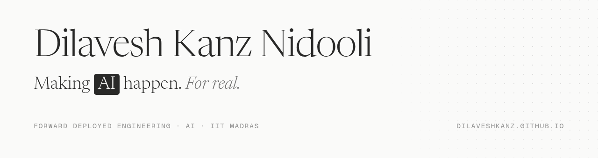

<picture>
  <source media="(prefers-color-scheme: dark)" srcset="assets/banner-dark.png">
  
</picture>

  

  
  
  
  

 

### About

I build AI and software and get it working for the people who use it. I study Data Science and Applications at **IIT Madras** and work as a Software Developer Intern at **CODE, IIT Madras**.

I am looking for a **Forward Deployed Engineer internship**. I am also open to AI engineering, ML, software, intelligent systems, robotics, and autonomous-agent roles.

### Now

- Fine-tuning AltiMap for **Smart India Hackathon 2026**
- Building fest modules on the **Paradox WebOps** core team
- Competing in **e-Yantra**, the IIT Bombay robotics competition

### Selected work

<table>
  <tr><td><b>Course Planner</b></td><td>Helps IIT Madras students plan their courses. Live in four degree programmes.</td><td>CODE · live</td></tr>
  <tr><td><b>Paradox Fest Platform</b></td><td>Runs events and sign-ups for the IIT Madras BS student fest.</td><td>Paradox · active</td></tr>
  <tr><td><b>FieldPilot AI</b></td><td>A phone camera that watches a construction site and warns workers out loud. I trained the part that recognises safety gear.</td><td>Kaya AI · finalist</td></tr>
  <tr><td><b><a href="https://github.com/ManasBytes/altimap">AltiMap</a></b></td><td>Works out how tall every building is from a single photo taken from above.</td><td>SIH 2026 · ongoing</td></tr>
  <tr><td><b>Live Dress Try-On</b></td><td>A live mirror that shows you wearing a dress as you move.</td><td>prototype · ongoing</td></tr>
  <tr><td><b>DealFlow360</b></td><td>Tracks a sale from the first quote to the final delivery.</td><td>Odoo · finalist</td></tr>
  <tr><td><b><a href="https://github.com/mbiplab-dev/Sparkz-AssetFlow">AssetFlow</a></b></td><td>Lets a team share equipment without two people booking it at once.</td><td>Odoo · qualifier</td></tr>
  <tr><td><b><a href="https://github.com/DilaveshKanz/Webops-RAG-Project">Discourse Q&amp;A</a></b></td><td>Answers student questions from the course forum, and shows where each answer came from.</td><td>WebOps task</td></tr>
</table>

See every project, with live animations of how each one works, at <a href="https://dilaveshkanz.github.io">dilaveshkanz.github.io</a>.

### Experience

<table>
  <tr><td><b>CODE, IIT Madras</b></td><td>Software Developer Intern</td><td>Jul 2026 – now</td></tr>
  <tr><td></td><td>Operations Intern</td><td>Mar – Jun 2026</td></tr>
  <tr><td><b>Paradox, IIT Madras</b></td><td>WebOps Core</td><td>Nov 2025 – now</td></tr>
  <tr><td></td><td>Graphic Design, Paradox Multimedia</td><td>Aug 2024 – 2025</td></tr>
</table>

### Toolbox

<picture>
  <source media="(prefers-color-scheme: dark)" srcset="https://skillicons.dev/icons?i=py%2Cts%2Cjs%2Cpytorch%2Csklearn%2Cfastapi%2Cflask%2Cnestjs%2Cnextjs%2Creact%2Cvue%2Cpostgres%2Credis%2Cgcp%2Cgit&theme=dark&perline=15">
  
</picture>

### Contributions

<picture>
  <source media="(prefers-color-scheme: dark)" srcset="https://raw.githubusercontent.com/DilaveshKanz/DilaveshKanz/output/snake-dark.svg">
  
</picture>

Making AI happen. For real. · <a href="https://dilaveshkanz.github.io">dilaveshkanz.github.io</a>

