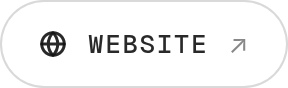
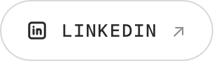
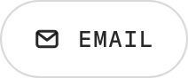

<picture>
  <source media="(prefers-color-scheme: dark)" srcset="assets/banner-dark.png">
  
</picture>

  

  <a href="https://dilaveshkanz.github.io"><picture><source media="(prefers-color-scheme: dark)" srcset="assets/btn-open-dark.png"></picture></a>
  <a href="https://dilaveshkanz.github.io"><picture><source media="(prefers-color-scheme: dark)" srcset="assets/btn-site-dark.png"></picture></a>
  <a href="https://www.linkedin.com/in/dilavesh-kanz-nidooli/"><picture><source media="(prefers-color-scheme: dark)" srcset="assets/btn-linkedin-dark.png"></picture></a>
  <a href="mailto:dilaveshkanz@gmail.com"><picture><source media="(prefers-color-scheme: dark)" srcset="assets/btn-email-dark.png"></picture></a>

 

### Toolbox

<picture>
  <source media="(prefers-color-scheme: dark)" srcset="https://skillicons.dev/icons?i=py%2Cts%2Cjs%2Cpytorch%2Csklearn%2Cfastapi%2Cflask%2Cnestjs%2Cnextjs%2Creact%2Cvue%2Cpostgres%2Credis%2Cgcp%2Cgit&theme=dark&perline=15">
  
</picture>

### Contributions

<picture>
  <source media="(prefers-color-scheme: dark)" srcset="https://raw.githubusercontent.com/DilaveshKanz/DilaveshKanz/output/snake-dark.svg">
  
</picture>

Making AI happen. For real. · <a href="https://dilaveshkanz.github.io">dilaveshkanz.github.io</a>

